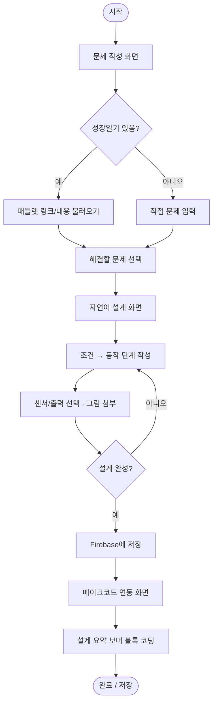
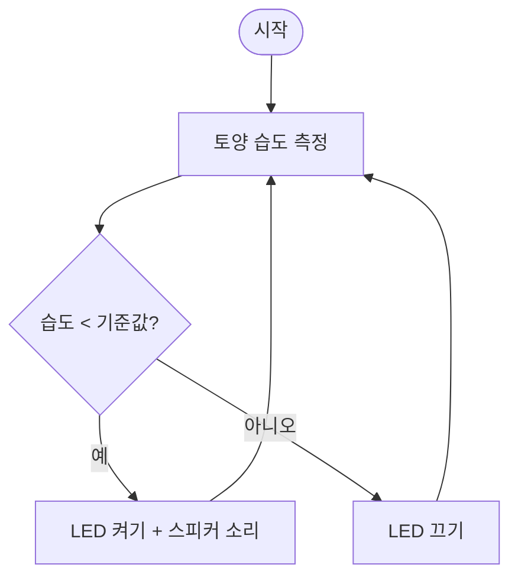

# spec.md — 제품 요구사항 정의서 (PRD)

## 1. 개요

**마이크로비트로 만드는 무순(새싹채소) 관리 에이전트 설계 웹 앱**의 제품 요구사항 정의서입니다.

- **문서 버전**: v0.1
- **작성일**: 2026-10-29
- **관련 문서**: [CLAUDE.md](CLAUDE.md)(상시 컨텍스트), [review.md](review.md)(리뷰 체크리스트)

## 2. 목적 (Why)

아이들이 **실생활 문제**인 "무순 키우기"에서 직접 겪은 어려움을,
**설계를 통해 스스로 해결**해보도록 하는 것이 목적입니다.

- 무순을 자동으로 키워주는 장치가 아니라, 학생이 **자기 문제를 정의 → 설계 → 구현**하는 전 과정을 경험하게 하는 **교육용 도구**입니다.
- 코딩과 설계가 "내 문제를 푸는 도구"임을 체감하게 합니다.

## 3. 대상 사용자 (Who)

- **주 사용자: 중학교 1학년 학생**
- 보조 사용자: 수업을 운영하는 교사
- 특성: 순서도 작성에 익숙하지 않음 → **자연어로 알고리즘/기능을 표현**하는 방식을 기본 지원해야 함.

## 4. 사용자 흐름 (User Flow)

```
[1] 문제 발견·작성  →  [2] 자연어 설계(기능 설명, 그림 가능)  →  [3] 메이크코드 연동 개발
```

학생은 위 3단계를 순서대로 진행하며, 각 단계의 결과물이 다음 단계의 입력이 됩니다.

## 5. 핵심 기능 (Must-have)

### 기능 1. 문제 작성 (문제 발견)

- **패들렛(Padlet)에 작성했던 성장일기**를 기반으로, 또는 **본인이 체험하면서 발견한 문제**를 직접 작성할 수 있어야 한다.
- 입력 요소
  - 성장일기 내용 참고/붙여넣기(또는 패들렛 링크 첨부)
  - 겪은 문제 서술 (예: "주말에 물 주는 걸 깜빡해서 무순이 말랐다")
- 요구사항
  - 중1 눈높이의 쉬운 안내 문구와 예시 제공
  - 작성 내용이 유실되지 않도록 저장
  - 여러 문제 중 해결할 **하나의 문제를 선택**할 수 있게 함

### 기능 2. 자연어 설계 (마이크로비트 설계 전 단계)

- 본인의 문제를 해결하기 위한 마이크로비트 기능을, **설계(코딩) 전에 자연어로 설명**할 수 있어야 한다.
- 입력 요소
  - 자연어 기능 설명 (예: "흙이 마르면 LED를 켜고 스피커로 소리를 낸다")
  - **"조건 → 동작" 형태**로 단계를 쉽게 적도록 안내 (순서도를 못 그려도 완성 가능)
  - **그림/이미지 첨부 가능** (손그림 사진, 스케치 등 업로드)
- 요구사항
  - 순서도의 대안으로 자연어 입력을 항상 제공
  - 사용할 센서/출력을 고르거나 적을 수 있게 함 (배운 7종 + LED/스피커 기본, 필요 시 자유 추가)
  - 이 단계 결과가 기능 3의 개발 기초가 됨

### 기능 3. 메이크코드 연동 개발

- 설계한 내용을 기반으로 **실제 메이크코드(MakeCode) 홈페이지를 연동**하여 개발할 수 있어야 한다.
- 요구사항
  - 메이크코드(makecode.microbit.org)로 이동/임베드하여 학생이 바로 블록 코딩을 시작할 수 있게 연결
  - 기능 2에서 정리한 자연어 설계(조건 → 동작, 센서 목록)를 **참고용으로 함께 보여주기** (학생이 보면서 구현)
  - 학생이 직접 설계·구현하는 것이 핵심이므로, 코드를 대신 완성해주지 않는다 (비계 제공)

## 6. 비기능 요구사항

- **접근성**: 중1 수준의 쉬운 한국어, 큰 글씨/충분한 대비, 키보드 접근 가능.
- **반응형**: 수업 환경(태블릿/노트북)에서 동작.
- **데이터 보존**: 학생 작성물(문제, 설계, 이미지) 유실 방지.
- **개인정보**: 민감정보 불필요하게 수집·노출하지 않음.
- **언어**: 기본 한국어.

## 7. 기대효과

- 실생활 문제 해결 경험으로 코딩의 유용성 체감
- 자연어 설계로 알고리즘적 사고를 끝까지 완성 (중도 포기 감소)
- 메이크코드 연동으로 아이디어를 실제 동작하는 결과물로 구현
- 중1 맞춤 접근성으로 부담 없이 참여

## 8. 범위 밖 (Out of scope, 현재 버전)

- 무순 재배를 자동 제어하는 실제 하드웨어 운영
- 교사용 성적/평가 관리 시스템
- 학생 계정·로그인 기반의 복잡한 사용자 관리 (추후 검토)

## 9. 미정 사항 (TBD)

- 기술 스택(프런트엔드 프레임워크 등)
- 패들렛 연동 방식(링크 첨부 vs API 연동)
- 메이크코드 연동 방식(새 탭 이동 vs iframe 임베드)
- ~~학생 작성물 저장 위치~~ → **Firebase(Firestore + Storage)로 결정** (11장 참고)

---

## 10. 와이어프레임 (UI 설계)

유저 시나리오를 화면 단위로 표현한 저해상도 와이어프레임입니다. 중1 눈높이에 맞춰 화면당 한 가지 일에 집중하고, 상단에 3단계 진행 표시를 둡니다.

### 공통 레이아웃

```
┌───────────────────────────────────────────────┐
│  🌱 무순 관리 에이전트 설계                      │   ← 헤더(로고/제목)
├───────────────────────────────────────────────┤
│  [1 문제 작성] → [2 자연어 설계] → [3 개발]     │   ← 진행 단계 표시(현재 단계 강조)
├───────────────────────────────────────────────┤
│                                                 │
│                 (단계별 본문)                    │
│                                                 │
├───────────────────────────────────────────────┤
│              [ 이전 ]        [ 다음 ]           │   ← 이동 버튼
└───────────────────────────────────────────────┘
```

### 화면 1 — 문제 작성

```
┌───────────────────────────────────────────────┐
│  [1 문제 작성] → 2 자연어 설계 → 3 개발          │
├───────────────────────────────────────────────┤
│  무순을 기르면서 어떤 문제가 있었나요?           │
│                                                 │
│  내 성장일기 가져오기                            │
│  ┌─────────────────────────────────────────┐   │
│  │ 패들렛 링크 붙여넣기:  [________________] │   │
│  │ 또는 성장일기 내용 붙여넣기:              │   │
│  │ [                                      ] │   │
│  └─────────────────────────────────────────┘   │
│                                                 │
│  내가 발견한 문제 (예: 주말에 물을 못 줬어요)    │
│  ┌─────────────────────────────────────────┐   │
│  │ [                                      ] │   │
│  │ [                                      ] │   │
│  └─────────────────────────────────────────┘   │
│  [ + 문제 추가 ]                                │
│                                                 │
│  해결할 문제 고르기:  (◉ 물 부족  ○ 빛 부족 …) │
├───────────────────────────────────────────────┤
│                              [ 다음: 설계 → ]   │
└───────────────────────────────────────────────┘
```

### 화면 2 — 자연어 설계

```
┌───────────────────────────────────────────────┐
│  1 문제 작성 → [2 자연어 설계] → 3 개발          │
├───────────────────────────────────────────────┤
│  선택한 문제: "주말에 물을 못 줘서 말랐어요"     │
│                                                 │
│  어떻게 해결할지 말로 설명해요 (조건 → 동작)     │
│  ┌─────────────────────────────────────────┐   │
│  │ 조건: [흙이 마르면________]              │   │
│  │ 동작: [LED를 켜고 소리를 낸다____]        │   │
│  │ [ + 단계 추가 ]                          │   │
│  └─────────────────────────────────────────┘   │
│                                                 │
│  사용할 센서/부품 (선택, 필요하면 추가 가능)      │
│  [✓토양습도] [ ]온도 [ ]조도 [✓LED] [✓스피커…  │
│  [ + 새 센서 추가 ]                             │
│                                                 │
│  그림으로도 표현하기 (선택)                      │
│  ┌───────────────┐                              │
│  │  🖼 이미지 업로드 │   [ 파일 선택 ]            │
│  └───────────────┘                              │
├───────────────────────────────────────────────┤
│   [ ← 이전 ]               [ 다음: 개발 → ]     │
└───────────────────────────────────────────────┘
```

### 화면 3 — 메이크코드 연동 개발

```
┌───────────────────────────────────────────────┐
│  1 문제 작성 → 2 자연어 설계 → [3 개발]          │
├───────────────────────────────────────────────┤
│  내 설계 요약            │   메이크코드          │
│  ┌────────────────────┐ │ ┌───────────────────┐ │
│  │ 문제: 물 부족       │ │ │                   │ │
│  │ 조건→동작:          │ │ │  (makecode        │ │
│  │ · 흙이 마르면       │ │ │   microbit.org    │ │
│  │   LED 켜고 소리     │ │ │   임베드 또는     │ │
│  │ 센서: 토양습도      │ │ │   새 탭으로 열기) │ │
│  │ 출력: LED, 스피커   │ │ │                   │ │
│  └────────────────────┘ │ └───────────────────┘ │
│                         │  [ 메이크코드 열기 ↗ ] │
├───────────────────────────────────────────────┤
│   [ ← 이전 ]                    [ 저장 / 완료 ] │
└───────────────────────────────────────────────┘
```

> 설계 요약을 왼쪽에 고정해 두어, 학생이 보면서 직접 블록 코딩을 하도록 한다. (코드를 대신 완성하지 않음)

---

## 11. 핵심 로직 (순서도 / 알고리즘)

### 11.1 앱 전체 흐름 (순서도)



### 11.2 학생이 만드는 마이크로비트 로직 예시 (자연어 알고리즘)

"조건 → 동작" 형태로, 순서도를 못 그려도 완성할 수 있게 한다.

```
예시) 물 부족 알림 에이전트
1. 토양 습도 센서로 흙의 습도를 계속 측정한다.
2. 만약 습도가 기준값(예: 30%)보다 낮으면
      - LED를 켠다 (예: 물방울 아이콘)
      - 스피커로 소리를 낸다
   그렇지 않으면
      - LED를 끈다
3. 1번으로 돌아가 반복한다.
```

### 11.3 위 예시의 순서도



> 이 자연어 알고리즘/순서도는 **학생이 작성하는 결과물**이며, 앱은 작성을 돕는 틀(조건·동작 입력, 예시)을 제공한다.

---

## 12. Firebase 데이터 구조

저장소는 **Firebase**를 사용한다. 텍스트/구조 데이터는 **Firestore**, 업로드 이미지는 **Firebase Storage**에 저장하고 Firestore에는 그 URL만 보관한다.

### 12.1 컬렉션 구조 (Firestore)

```
projects (컬렉션)
└── {projectId} (문서)
    ├── owner            : string   // 학생 닉네임 또는 익명 식별자
    ├── className        : string   // 반/모둠 (선택)
    ├── createdAt        : timestamp
    ├── updatedAt        : timestamp
    ├── currentStep      : number   // 1 | 2 | 3 (진행 단계)
    │
    ├── problem (map)               // [기능 1] 문제 작성
    │   ├── source        : string  // "padlet" | "self"
    │   ├── padletUrl     : string  // 패들렛 링크 (선택)
    │   ├── growthDiary   : string  // 성장일기 내용 (선택)
    │   ├── candidates    : array<string>  // 발견한 문제 목록
    │   └── selected      : string  // 해결할 문제로 고른 것
    │
    ├── design (map)                // [기능 2] 자연어 설계
    │   ├── description   : string  // 자연어 기능 설명
    │   ├── steps         : array<map>      // 조건 → 동작 단계
    │   │   └── { order: number, condition: string, action: string }
    │   ├── sensors       : array<string>   // 예: ["soilMoisture"]
    │   ├── outputs       : array<string>   // 예: ["led","speaker"]
    │   ├── extraSensors  : array<string>   // 배운 범위 밖 추가 센서
    │   └── imageUrls     : array<string>   // Storage 이미지 URL
    │
    └── makecode (map)              // [기능 3] 메이크코드 연동
        ├── projectUrl    : string  // 메이크코드 프로젝트/공유 URL
        ├── shareId       : string  // 공유 식별자 (선택)
        └── status        : string  // "notStarted" | "inProgress" | "done"
```

### 12.2 문서 예시 (JSON)

```json
{
  "owner": "무순이1",
  "className": "1-3",
  "createdAt": "2026-10-29T09:00:00Z",
  "updatedAt": "2026-10-29T09:30:00Z",
  "currentStep": 2,
  "problem": {
    "source": "padlet",
    "padletUrl": "https://padlet.com/...",
    "growthDiary": "주말 동안 물을 못 줬더니 무순이 축 처졌다.",
    "candidates": ["주말에 물 주기를 깜빡함", "빛이 부족함"],
    "selected": "주말에 물 주기를 깜빡함"
  },
  "design": {
    "description": "흙이 마르면 알려주는 장치를 만든다.",
    "steps": [
      { "order": 1, "condition": "흙이 마르면", "action": "LED를 켜고 스피커로 소리를 낸다" },
      { "order": 2, "condition": "흙이 촉촉하면", "action": "LED를 끈다" }
    ],
    "sensors": ["soilMoisture"],
    "outputs": ["led", "speaker"],
    "extraSensors": [],
    "imageUrls": ["https://firebasestorage.googleapis.com/.../sketch1.png"]
  },
  "makecode": {
    "projectUrl": "https://makecode.microbit.org/...",
    "shareId": "_abc123",
    "status": "inProgress"
  }
}
```

### 12.3 Firebase Storage 경로 규칙

```
project-images/{projectId}/{파일명}      // 설계 단계 그림/스케치 업로드
```

> 참고: 현재 버전은 복잡한 로그인(사용자 인증)을 범위 밖으로 둔다(8장). `owner`는 닉네임/익명 식별자로 시작하고, 인증 도입 시 Firebase Auth의 uid로 확장할 수 있다. 보안 규칙(읽기/쓰기 권한)은 구현 단계에서 별도로 정의한다.

---

## 13. 수용 기준 (Acceptance Criteria)

각 기능이 "완료"로 인정되는 조건입니다. `Given(상황) → When(행동) → Then(결과)` 형태로 기술합니다.

### 기능 1. 문제 작성

- **AC1-1** Given 학생이 패들렛 성장일기를 가지고 있을 때, When 링크를 붙여넣거나 내용을 입력하면, Then 그 내용이 화면에 보이고 저장된다.
- **AC1-2** Given 성장일기가 없을 때, When 직접 문제를 입력하면, Then 문제가 목록에 추가된다.
- **AC1-3** Given 여러 문제를 작성했을 때, When 하나를 선택하면, Then 선택한 문제가 다음 단계로 전달된다.
- **AC1-4** Given 문제를 선택하지 않았을 때, When "다음"을 누르면, Then 다음 단계로 넘어가지 않고 안내 문구가 표시된다.
- **AC1-5** 작성 중 페이지를 새로고침해도 입력 내용이 유실되지 않는다.

### 기능 2. 자연어 설계

- **AC2-1** Given 문제가 선택된 상태에서, When "조건 → 동작" 단계를 입력하면, Then 단계가 순서대로 추가·표시된다.
- **AC2-2** 순서도를 그리지 않아도, 자연어 입력만으로 설계를 완성할 수 있다.
- **AC2-3** Given 센서/출력 목록에서, When 항목을 선택하거나 새 센서를 추가하면, Then 설계에 반영된다.
- **AC2-4** Given 그림을 첨부할 때, When 이미지를 업로드하면, Then 미리보기가 보이고 Storage에 저장된 URL이 설계에 연결된다.
- **AC2-5** Given 조건 또는 동작이 비어 있을 때, When "다음"을 누르면, Then 넘어가지 않고 보완 안내가 표시된다.

### 기능 3. 메이크코드 연동 개발

- **AC3-1** Given 설계가 저장된 상태에서, When 개발 화면에 진입하면, Then 왼쪽에 내 설계 요약(문제·조건→동작·센서·출력)이 표시된다.
- **AC3-2** When "메이크코드 열기"를 누르면, Then makecode.microbit.org가 임베드 또는 새 탭으로 열려 블록 코딩을 시작할 수 있다.
- **AC3-3** 앱이 코드를 대신 완성하지 않고, 설계 요약을 참고 자료로만 제공한다.
- **AC3-4** When 개발 상태를 저장하면, Then `makecode.status`가 갱신되고 Firestore에 반영된다.

### 공통 / 비기능 수용 기준

- **AC-C1** 모든 안내 문구가 중1 수준의 쉬운 한국어로 작성되어 있다.
- **AC-C2** 태블릿·노트북 화면에서 레이아웃이 깨지지 않고 반응형으로 동작한다.
- **AC-C3** 3단계 진행 표시가 항상 현재 단계를 올바르게 보여준다.
- **AC-C4** 학생 작성물(문제·설계·이미지)이 Firebase에 저장되고 다시 불러올 수 있다.
- **AC-C5** 민감 개인정보를 수집·노출하지 않는다.

---

## 14. 검증 기준 (Verification Criteria)

수용 기준을 "어떻게 확인할 것인가"를 정의합니다. 각 항목은 통과/실패를 판단할 수 있어야 합니다.

### 14.1 기능 검증 (수동 테스트 시나리오)

| 번호 | 검증 시나리오 | 통과 조건 | 관련 AC |
|------|---------------|-----------|---------|
| V-1 | 패들렛 링크 + 성장일기 입력 후 저장 | 새로고침 후에도 내용 유지 | AC1-1, AC1-5 |
| V-2 | 문제 미선택 상태로 "다음" 클릭 | 이동 차단 + 안내 표시 | AC1-4 |
| V-3 | 조건·동작 2단계 입력 → 단계 추가 | 입력 순서대로 표시 | AC2-1 |
| V-4 | 자연어만으로 설계 완료 | 순서도 없이 다음 단계 진입 가능 | AC2-2 |
| V-5 | 새 센서 추가 | 목록에 추가되고 설계에 반영 | AC2-3 |
| V-6 | 이미지 업로드 | 미리보기 표시 + URL 저장 | AC2-4 |
| V-7 | 개발 화면 진입 | 설계 요약이 좌측에 정확히 표시 | AC3-1 |
| V-8 | "메이크코드 열기" 클릭 | makecode 페이지 연결 | AC3-2 |
| V-9 | 전 과정 진행 후 재접속 | 저장된 프로젝트 불러오기 성공 | AC-C4 |

### 14.2 데이터 검증

- **D-1** 저장된 Firestore 문서가 12장 구조(`problem` / `design` / `makecode`)를 따른다.
- **D-2** `design.steps`의 각 항목에 `order`, `condition`, `action`이 모두 존재한다.
- **D-3** 업로드 이미지가 `project-images/{projectId}/` 경로에 저장되고, Firestore에는 해당 URL만 보관된다.
- **D-4** `currentStep` 값이 실제 진행 단계와 일치한다.

### 14.3 비기능 검증

- **N-1** (접근성) 주요 입력·버튼을 키보드만으로 조작할 수 있고, 색 대비가 충분하다.
- **N-2** (반응형) 태블릿/노트북 해상도에서 가로 스크롤 없이 표시된다.
- **N-3** (문구) 무작위 추출한 안내 문구가 중1이 이해할 수 있는 수준이다.
- **N-4** (안정성) 콘솔 에러 없이 전 과정이 동작한다.
- **N-5** (코드 품질) [review.md](review.md) 체크리스트 기준의 1차 리뷰를 통과한다.

### 14.4 검증 방법

- 1차: **AI 코드 리뷰** — [review.md](review.md)의 체크리스트를 근거로 수행.
- 2차: **수동 테스트** — 위 V/D/N 시나리오를 실제 조작으로 확인.
- 3차(선택): 교사/학생 대상 **사용성 점검** — 중1이 안내 없이 3단계를 완주할 수 있는지 관찰.

> MVP 완료 기준: 13장의 모든 수용 기준(AC)을 충족하고, 14장의 V/D/N 검증을 통과한다.
